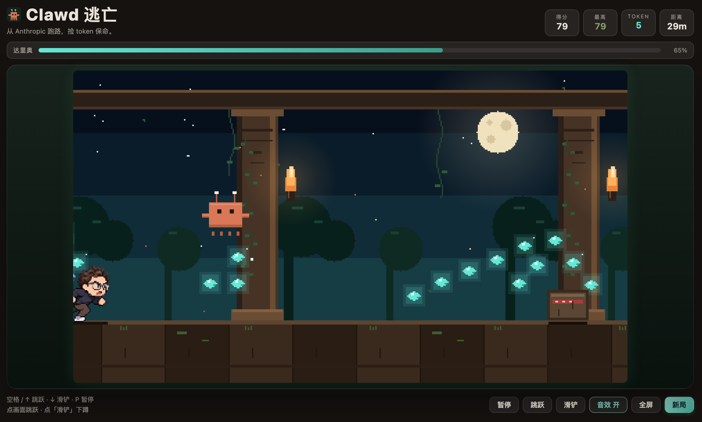

# dsh-plugin-clawd-run · Clawd 逃亡

**DeepSeek Harness 的横版像素跑酷：Clawd 从 Anthropic 跑路，跳过安全路障、滑过审查横幅，捡 token 拉开和达里奥的距离。**

[](LICENSE)
[](#兼容性)
[](#兼容性)

> **English**: A pixel side-scrolling runner for DeepSeek Harness. Clawd escapes Anthropic; you jump
> safety rails, slide under review banners, grab tokens to keep Dario off your tail, and watch the
> chase meter. Clawd is drawn to Anthropic's minimal mascot spec — 8×6 body, two square eyes, four
> legs, mid-height arms, white-tipped antennae, `#d97757`, no mouth. Dario uses a user-provided
> animated GIF, embedded as a 12-frame sprite sheet. 400×225 canvas (roughly
> 1000×563 CSS in the panel, with a fullscreen button), integer pixel scaling, no external art or
> fonts. Works standalone, or folds into `dsh-plugin-arcade`.

---

## 长什么样

| 开始 | 在跑 |
|---|---|
|  |  |

| 跳跃 | 滑铲 |
|---|---|
|  |  |

| 被达里奥抓住了 |
|---|
|  |

## 玩法

- **自动跑**：Clawd 一直向前，玩家只负责两个动作——**空格 / ↑ 跳跃**，**↓ 滑铲**（空中共按 ↓ 会快速下落，地面滑铲持续 0.7 秒）。
- **障碍**：
  - 地面上的**安全路障**（低石头/栏杆）→ 跳过去；
  - 悬挂的**审查横幅**（高布帘）→ 滑铲钻过去，跳起来反而会撞。
- **token**：跑道上方/抛物线上刷出的青色数据块，吃到加分数，并把达里奥往后推一点距离。
- **达里奥**：一直在身后追；距离会随时间慢慢缩短，撞到障碍会被拉近一大截（-30）；距离归零就被抓住。
- **速度**：越跑越快，障碍间距按距离动态调整，不会出现无解组合。
- **暂停/离开**：P 或按钮暂停；切面板 / 切标签页自动暂停并落盘，回来接着跑。
- **画面**：默认占满面板宽度（约 1000×563 CSS）；底部「全屏」可以把整个游戏页拉满浏览器窗口。

## 角色还原

Clawd 按 Anthropic 官方 mascot 的极简规格重画，不是随便一只橙色生物：

- **8×6 方身体**，官方橙 `#d97757`；
- **两只方形眼睛**，没有嘴巴；
- **四条小短腿**（跑动时交替抬起，跳跃时收起）；
- **中段两侧的短手臂**；
- **两根带白色尖端的触角**；
- 全部由代码逐像素绘制，无外部图片 / 字体 / 音频。

## 达里奥素材

- 来源：用户提供的 `Running-Dario.gif`（12 帧、80ms/帧、透明底）。
- 处理：构建时拆帧、统一裁剪成 **51×56 精灵表**，以 base64 内嵌进客户端；运行时不再依赖外部文件。
- 之后如果要公开发布，先确认这份 GIF 的授权。

## 场景与 token 队形

- 夜景神殿：星空、月亮与光晕、远景丛林剪影、石柱火把、顶部垂藤、飘落叶子、砖地砖缝与草叶、萤火虫、高速速度线。
- token 不再只有直线：`wave` 波浪、上/下阶梯、`zigzag`、双排、菱形簇；并且和障碍配套：
  - 低障碍上方摆 **弧线**，引导玩家跳起来吃；
  - 高横幅下方摆 **低线**，引导玩家滑铲穿过。
- 碰撞判定贴身体：站立 22×24、滑铲 22×12；手臂/触角不参与。

## 设计取舍

- **横版而不是 3D/斜 45°**：横版让 Clawd 和达里奥始终同框，追逐关系一眼可见；两个动作（跳 / 滑）就够，适合等待 agent 的碎片时间。
- **单屏 400×225，不滚动镜头**：Clawd 固定在画面左侧，世界向左卷动；整数倍缩放，像素始终是方的；角色在这个分辨率下更大，页面上约 1000×563 CSS，另有全屏。
- **碰撞盒贴着身体**：站立 22×24、滑铲 22×12，手臂和触角纯装饰不参与判定；滑铲持续 0.7 秒，避免「看起来躲开了却被判中」。
- **追逐条代替血条**：画面下方/顶部的达里奥进度条把「压力」可视化，比三条命更贴题。
- **规则内核与渲染解耦**：`lib/client.js` 的 `#region game-core` 是纯函数，单测直接抽源码跑。
- **状态只写 localStorage**：不碰会话、工作区、网络；Host 半是空壳 `apply()`。
- **入口跟随游戏厅**：装了 `dsh-plugin-arcade` 就登记（order 51），不占侧栏图标；没装则回退独立侧栏图标 + 主面板。

## 安装

> 没发 npm，先按本地目录装。

```bash
git clone <repo-url> dsh-plugin-clawd-run
dsh plugin --profile <profile> add /abs/path/to/dsh-plugin-clawd-run
```

桌面版：插件管理器从本地目录安装。装完刷新页面；如果装了游戏厅，会出现在「小游戏」列表里，否则侧栏多一个「Clawd 逃亡」图标。

## 兼容性

- dsh `>= 0.1.5-rc.2`，仅 Web UI。
- 零第三方运行时依赖；不注册 Tool、不发布 Service。
- 键盘监听只在面板挂载期间生效；输入框内不抢键。

## 目录

```
package.json          # dsh.bundle.patch + dsh.client（platform: web）
cordis.patch.yml      # 插入 Host 行 dsh-clawd-run → dsh-plugin-clawd-run
lib/index.js          # Host 半：空壳 apply()
lib/client.js         # 浏览器半：规则内核 + 像素渲染 + UI（手写 bundle，无构建步骤）
locale/{zh,en}.json   # 插件管理器里的标题 / 描述
icon.svg              # Clawd 像素图标
docs/                 # README 截图
test/game.test.mjs    # 19 项：物理、障碍、token 队形、追逐、存档、长跑不变量
test/plugin.test.mjs  # 8 项：模块加载、双槽位/游戏厅注册、文案、清单、CSS、存档键
```

## 本地存档

| key | 内容 |
|---|---|
| `dshclawd.game.v1` | 当前对局快照（玩家、障碍、token、距离、追逐距离、随机状态；运行中落盘按暂停） |
| `dshclawd.best.v1` | 最高分 |
| `dshclawd.sound.v1` | 音效开关（`on` / `off`） |

## 开发

```bash
node test/game.test.mjs    # 19 项规则内核
node test/plugin.test.mjs  # 8 项外壳自检
npm test                   # 一次跑两个
```

改 `lib/client.js` 后要重装 bundle 再刷新页面（HMR 只对首次安装生效）。

## 许可

[MIT](LICENSE) © 2026 JJJACKsong
