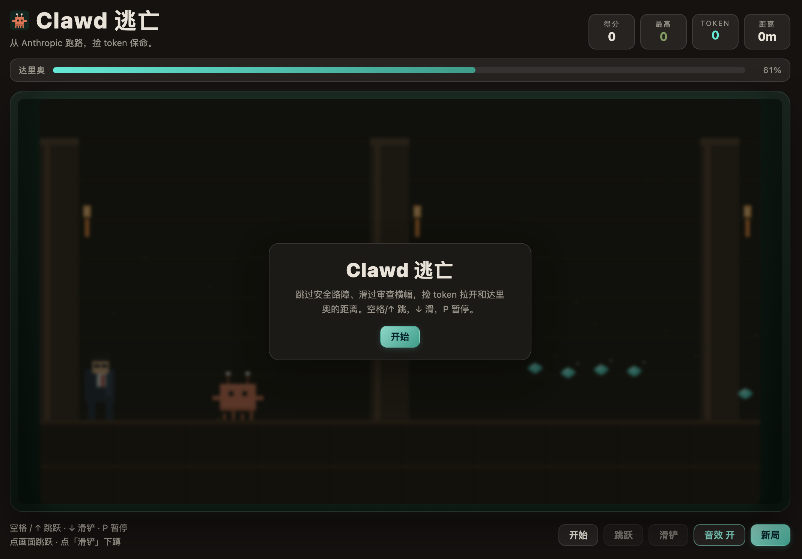
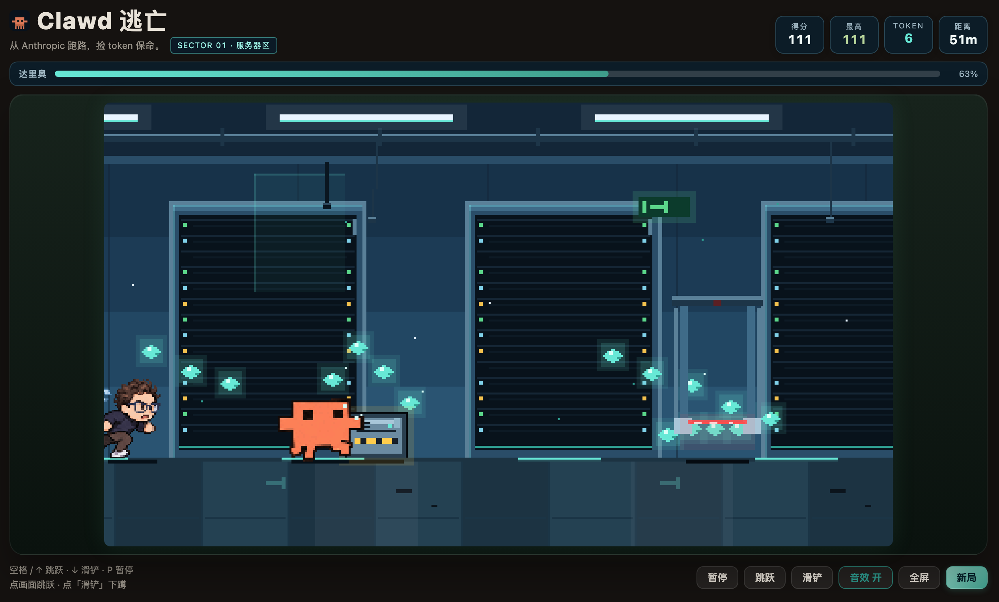
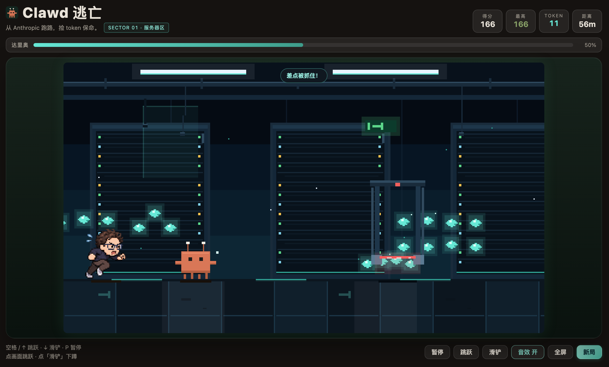
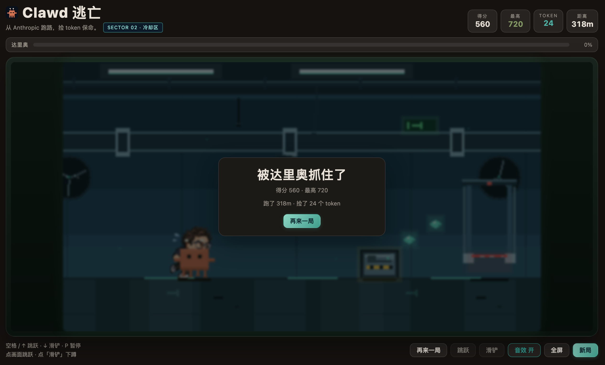

# dsh-plugin-clawd-run · Clawd 快跑

**DeepSeek Harness 的横版像素跑酷：Clawd 从 Anthropic 的服务器机房逃出，跳过倒下的服务器机箱、滑过安全激光门，捡 token 拉开和达里奥的距离。**

[](LICENSE)
[](#兼容性)
[](#兼容性)
[](https://www.npmjs.com/package/dsh-plugin-clawd-run)

> **English**: A pixel side-scrolling runner for DeepSeek Harness. Clawd escapes Anthropic's modern
> data center; you jump fallen server crates, slide under security laser gates, grab tokens to keep
> Dario off your tail, and watch the chase meter. Clawd uses user-provided running / sliding GIF
> animations (12 frames each), and Dario a user-provided running GIF — both embedded as sprite
> sheets. 400×225 canvas (roughly 1000×563 CSS in the panel, with a fullscreen button), integer
> pixel scaling. Opens on a proper start screen (record, sector preview, controls), and only
> starts running when you press start / Space / Enter. Works standalone, or folds into `dsh-plugin-arcade`.

---

## 开始界面

打开面板先进入标题页，不会直接开跑：

- 左侧：游戏标题、说明、**开始快跑**、音效开关、全屏、操作键位、历史最高分和当前区域；
- 右侧：Clawd / 达里奥的封面立绘（用游戏内精灵表）+ 机房网格；顶部 SECURITY BREACH，底部 ESCAPE // DATA CENTER 和区域名；
- 标题页不显示 HUD、角色和障碍，只留机房地景，避免误以为游戏已经开始；
- 点「开始快跑」、按空格或回车才正式进入游戏；
- 暂停、结算都是独立的深色 UI，有分数/距离/最高分网格和本局评价，不再用系统主题的白底弹层。

## 长什么样

> 下列截图来自 v0.7.1。v0.8.1 的新版场景需在 DSH 中重装并刷新插件查看；以下静态截图尚未重录。

| 开始 | 在跑 |
|---|---|
|  |  |

| 滑铲 | 被达里奥抓住了 |
|---|---|
|  |  |

## 玩法

- **自动跑**：Clawd 一直向前，玩家只负责两个动作——**空格 / ↑ 跳跃**，**↓ 滑铲**（空中共按 ↓ 会快速下落，地面滑铲持续 0.7 秒）。
- **障碍**：
  - 地面上的**倒下的服务器机箱**（低）→ 跳过去；
  - 悬挂的**安全激光门**（高）→ 滑铲从光束下穿过，跳起来会撞。
- **区域**：每 300m 换一个区（服务器区 → 冷却管道区 → 核心区），场景装饰和灯光随之变化，HUD 显示 `SECTOR`。
- **关卡图案**：障碍不再是逐个随机刷，而是按动作时间成组出现（单障碍 → 低高组合 → 三连交替）；任意两个障碍之间至少留 0.8 秒完成跳/滑。
- **Token 金币**：金色金币形成跳跃弧线／滑铲低线；安全路段会出现心形、菱形、箭头与爪印。收集可加分、拉远达里奥。
- **达里奥**：一直在身后追，体型放大到 60~66px；距离会随时间慢慢缩短，撞到障碍会被拉近一大截（-30）；距离归零就被抓住。
- **速度**：越跑越快，障碍间距按距离动态调整，不会出现无解组合。
- **暂停/离开**：P / Esc 或按钮暂停/继续；切面板 / 切标签页自动暂停并落盘，回来接着跑。
- **画面**：默认占满面板宽度（约 1000×563 CSS）；底部「全屏」可以把整个游戏页拉满浏览器窗口。

## 角色动画

- **Clawd**：用户提供的 `Clawd-running.gif`（12 帧、80ms/帧）和 `Clawd-sliding.gif`（12 帧、90ms/帧）。
  - 运行中播放 running 精灵表；滑铲播放 sliding 精灵表；
  - **滑铲不会缩小**：按同一角色比例绘制，滑铲帧高 28px（运行 36px，差距来自动作本身低伏，不是整体缩小）；
  - 滑铲只取 GIF 的 **#4~#7** 四帧，并统一裁切；#0~#3 是起身/过渡、#8~#11 是收尾，不适合当启动动作，全部去掉；
  - 滑铲启动固定从 #4 开始，再循环这 4 帧，不会随机从过渡帧起播；
  - 跳跃继续用 running 帧，靠整体位置表现起跳；
  - 两份 GIF 都拆成横向精灵表（46×36 / 62×28）base64 内嵌，运行时不再依赖外部文件；
  - 无敌帧不再让 Clawd 整只消失，改为白色四角闪框。
- **达里奥**：用户提供的 `Running-Dario.gif`（12 帧、80ms/帧），拆成 51×56 精灵表内嵌。
- 两份角色资产都是本地提供的参考素材；**公开发布前要确认授权**。

## HUD

- HUD 卡片固定为深色底 + 亮色字（不依赖浅色/深色主题变量），分数、最高分、TOKEN、距离在任何主题下都清楚。
- 游戏内提示条（如「差点被抓住！」）也改成固定深底 + 近白字 + 青色描边，不再受主题 overlay 颜色影响。
- SECTOR 标签、追逐条、按钮同样做了对比度处理。

## 区域与关卡（v0.8.1 视觉与资产修正）

- 地图以每 **300m** 为一大区，每大区再拆成四个 **75m** 片段：普通通道、设备区、挑战区、气闸出口。完成三大区循环后，中间两种场景的顺序会变化。
- **服务器区**偏向需要跳跃的服务器机箱，**冷却区**偏向需要滑铲的激光门，**核心区**偏向两种动作交替。障碍仍按速度留足动作时间。
- 每个区域边界前后各 24m 渐变背景和地面细节。气闸门固定在世界坐标的 300m 边界，过门不再是整幅背景突然切换。
- 新增的 Canvas 原生像素美术物件：**安全扫描控制台、冷却储液罐、核心密封舱、气闸门、警示灯和地面里程标记**。它们只属于背景层，不改变碰撞判定。
- **气闸出口段**只生成单个障碍，并增加下一组障碍的缓冲时间，避免每个区域都以高速三连结尾。
- **玩法可读性**：操作带背景专门降对比；低障碍固定黄橙色厚轮廓，高障碍固定鲜红激光并加向下箭头；金币为独立金黄色，不再与机房 LED 混淆。
- **金币安全摆放**：跳跃弧线按物理与当前速度计算、滑铲路线在激光两侧留白；取消独立计时器随机刷币，只在障碍组之间的安全空窗绘制图案。
- **原创像素道具**：三区共 12 件，参见 [完整 SVG 图集](assets/scene-atlas.svg) 与 [道具清单](assets/scene-atlas.json)。内嵌到客户端以便离线显示。
- 修复暂停/恢复时三连障碍的剩余生成时间被错误裁剪为 2 秒的问题；旧版存档可继续加载。
- 渲染结构仍然集中在 `lib/client.js`，无需新的构建工具或网络美术依赖；细节见 [地图设计说明](docs/map-design.md)。


- **SECTOR 01 服务器区**：玻璃机房、高低错落的机架组、安全门、状态屏、远景机架剪影。
- **SECTOR 02 冷却区**：横贯管廊、管件/阀门、风扇墙、控制室、地面格栅与冷光水洼。
- **SECTOR 03 核心区**：变压器柜、发光核心柱、导管墙、红色应急灯。
- 区域每 300m 切换一次，循环但难度继续上升。
- 地图不再是一排重复机架：顶部送风管/线缆桥架/吊牌/监控、墙面状态屏、地面线缆口/蒸汽口/逃生箭头都参与滚动视差；每个区域都有自己的大件结构和地面细节。
- 关卡图案按距离分档（<150m / <400m / <800m / 更高），间距以「动作时间」计算而不是固定像素，保证加速后仍可完成。

## 达里奥素材

- 来源：用户提供的 `Running-Dario.gif`（12 帧、80ms/帧、透明底）。
- 处理：构建时拆帧、统一裁剪成 **51×56 精灵表**，以 base64 内嵌进客户端；运行时不再依赖外部文件。
- 之后如果要公开发布，先确认这份 GIF 的授权。

## 场景与 token 队形

- 现代数据中心：顶部灯带与线缆、成排服务器机架与闪烁 LED、玻璃隔断、EXIT 出口牌、地面导光带与逃生箭头、冷却管道/风扇、核心区发光机组、数据粒子、高速速度线。
- 场景继续提亮墙面/机架/地面和障碍警示色；机架灯点、激光门红束、服务器机箱黄黑警示条更容易看清。
- HUD 改为固定深色卡片 + 亮字，不再出现「白底淡字」。
- 当前生成系统分为**障碍引导金币**（跳跃抛物线、激光门两侧滑铲低线）与**安全路段图案金币**（心形、菱形、箭头、爪印）。旧的 `wave` 等接口保留兼容，但不会再随机把金币散落到障碍附近。
- 碰撞判定贴身体：站立 22×24、滑铲 22×12；手臂/触角不参与。

## 设计取舍

- **横版而不是 3D/斜 45°**：横版让 Clawd 和达里奥始终同框，追逐关系一眼可见；两个动作（跳 / 滑）就够，适合等待 agent 的碎片时间。
- **单屏 400×225，不滚动镜头**：Clawd 固定在画面左侧，世界向左卷动；整数倍缩放，像素始终是方的；角色在这个分辨率下更大，页面上约 1000×563 CSS，另有全屏。
- **碰撞盒贴着身体**：站立 22×24、滑铲 22×12，手臂和触角纯装饰不参与判定；滑铲持续 0.7 秒，避免「看起来躲开了却被判中」。
- **追逐条代替血条**：画面下方/顶部的达里奥进度条把「压力」可视化，比三条命更贴题。
- **规则内核与渲染解耦**：`lib/client.js` 的 `#region game-core` 是纯函数，单测直接抽源码跑。
- **状态只写 localStorage**：不碰会话、工作区、网络；Host 半是空壳 `apply()`。
- **入口跟随游戏厅**：装了 `dsh-plugin-arcade` 就登记（order 51），不占侧栏图标；没装则回退独立侧栏图标 + 主面板。

## 安装

**从 npm**：

```bash
dsh plugin --profile <profile> add dsh-plugin-clawd-run
```

桌面版：插件管理器里按 npm 包名 `dsh-plugin-clawd-run` 安装。

**从 GitHub / 本地目录**（离线或改代码时）：

```bash
git clone https://github.com/JJJACKsong/dsh-plugin-clawd-run.git
dsh plugin --profile <profile> add /abs/path/to/dsh-plugin-clawd-run
```

装完刷新页面；如果装了游戏厅，会出现在「小游戏」列表里，否则侧栏多一个「Clawd 快跑」图标。

## 兼容性

- dsh `>= 0.1.5-rc.2`，仅 Web UI。
- 零第三方运行时依赖；不注册 Tool、不发布 Service。
- 键盘监听只在面板挂载期间生效；输入框内不抢键。

## 目录

```
package.json          # dsh.bundle.patch + dsh.client（platform: web）
cordis.patch.yml      # 插入 Host 行 dsh-clawd-run → dsh-plugin-clawd-run
lib/index.js          # Host 半：空壳 apply()
lib/client.js         # 浏览器半：规则内核 + 像素渲染 + UI（手写 bundle，无构建步骤）
locale/{zh,en}.json   # 插件管理器里的标题 / 描述
icon.svg              # Clawd 像素图标
docs/                 # README 截图
test/game.test.mjs    # 28 项：物理、地图、引导币、图案、安全间距、存档与长跑测试
assets/scene-atlas.svg # 12 格原创像素美术图集
assets/scene-atlas.json# 道具清单、坐标与区域定义
test/art.test.mjs     # 图集完整性与可读性自检
test/plugin.test.mjs  # 8 项：模块加载、双槽位/游戏厅注册、文案、清单、CSS、存档键
```

## 本地存档

| key | 内容 |
|---|---|
| `dshclawd.game.v1` | 当前对局快照（玩家、障碍、token、距离、追逐距离、随机状态；运行中落盘按暂停） |
| `dshclawd.best.v1` | 最高分 |
| `dshclawd.sound.v1` | 音效开关（`on` / `off`） |

## 开发

```bash
node test/game.test.mjs    # 28 项规则内核和金币回归
node test/plugin.test.mjs  # 8 项外壳自检
node test/art.test.mjs     # 原创图集及画面识别度自检
npm test                   # 一次跑三套
```

改 `lib/client.js` 后要重装 bundle 再刷新页面（HMR 只对首次安装生效）。

## 许可

[MIT](LICENSE) © 2026 JJJACKsong
